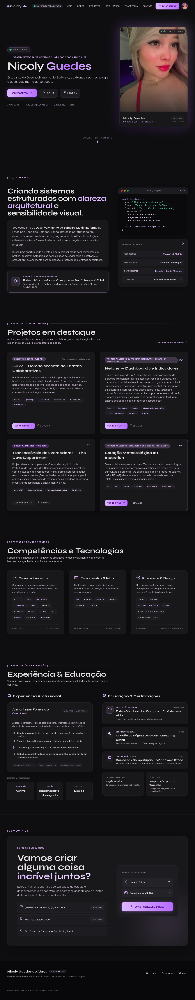

# Portfólio — Nicoly Guedes de Abreu

Portfólio pessoal de desenvolvedora de software, construído com **Vite**, **Tailwind CSS** e JavaScript puro.
Design "Obsidian Violet" originalmente prototipado no Stitch (veja [`docs/DESIGN.md`](docs/DESIGN.md)).



## Como rodar

```bash
npm install
npm run dev      # servidor local com hot reload
npm run build    # gera a pasta dist/ para produção
npm run preview  # testa o build localmente
```

## Estrutura

```
├── index.html            # esqueleto da página (inclui os componentes)
├── src/
│   ├── components/       # uma seção por arquivo (header, hero, projects...)
│   ├── data/site.json    # e-mail, telefone e links — editar num lugar só
│   ├── js/main.js        # modal de projetos, copiar contato, menu mobile
│   └── styles/           # style.css (entrada), base.css, components.css
├── tailwind.config.js    # cores e fontes do design system
├── docs/                 # DESIGN.md e preview
└── .github/workflows/    # deploy automático no GitHub Pages
```

## Editando o conteúdo

- **Contatos e links:** `src/data/site.json`
- **Projetos:** `src/components/projects.html` (cada card tem `data-title`, `data-description` e `data-url` para o modal)
- **Cores e fontes:** `tailwind.config.js`

## Deploy

- **GitHub Pages:** em _Settings → Pages → Source_, escolha **GitHub Actions**. Todo push na `main` publica o site.
- **Vercel/Netlify:** importe o repositório (build `npm run build`, saída `dist`).
